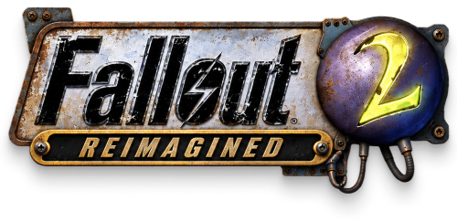

<h1 align="center"></h1>

**English** | [Русский](README.ru.md)

https://github.com/user-attachments/assets/a922572c-d8ae-4121-b489-971a467a1e6a

[Watch in 1080p on YouTube](https://www.youtube.com/watch?v=rFMGHM7ZNDc)

This project is made out of love for, and as a tribute to, Fallout 2, the
best game in the world: the game I grew up on and still play through every
couple of years.

The main goal: make the game run, and run smoothly, on modern computers with
monitors of any resolution. Along the way the visuals get a gentle lift, with
nothing extreme: the 3D view is there, but mostly for fun. Fallout 2's
atmosphere is kept whole; the original game is at the core.

It is a non-commercial project made for myself, but anyone is welcome to
contribute. If you want to take part, message me on
[Telegram](https://t.me/stepanov_e) or just send a PR.

## Install

[Download the launcher](https://github.com/Eugenius-S/f2-reimagined/releases/download/latest/fallout2-ce-3d-launcher.exe)
from the rolling [latest release](https://github.com/Eugenius-S/f2-reimagined/releases/tag/latest).

1. Install Fallout 2 from Steam or GOG.
2. Run the launcher. It detects those installs; if it cannot find the game,
   choose its folder containing `master.dat` and `critter.dat`.
3. Choose English or Russian for the launcher. To play in Russian, select
   **Install Russian text**; the launcher downloads it from the official RPU
   release. The Restoration Project option is shown as coming soon.
4. Choose **Install / Update**. Turn on automatic updates if you want the
   launcher to install a newer build when it starts. Press **Play** when the
   installation finishes. **Roll back** restores the previous build.

An internet connection is needed for a new install, updates and the optional
Russian text download.

The launcher installs or updates `fallout2-ce.exe`, `ce.dat` and
`scene-exporter.exe`, then builds scene data from your game files. An existing
`fallout2.cfg` is kept during install and updates; if you choose Russian, only
`[system].language` is set to `russian`. A default config is installed only
when it is missing. The launcher does not replace the original `fallout2.exe`
or alter save files.

## What works

- Buildings and many objects are converted into full 3D by algorithm.
- A sky above the 3D view instead of black.
- Sun and moon shadows: every solid 3D object casts a shadow that follows
  game time. Characters darken as they step into a building's shadow.
- Cloud shadows.
- Glow: toxic slime pools, burning barrels, lamps, screens and energy
  weapons.
- Dynamic light: lamps, fires and muzzle flashes light the walls and floor
  around them.
- The camera can turn; mouse-wheel zoom is smooth. Characters and objects
  that have several views in the game turn with the camera.
- Sharp text: a more readable, softer-contrast font, and dialogue and small
  interface text are no longer blurry (can be turned off in the menu).
- The game runs at any resolution and on wide monitors; loading screens and
  menus fill the screen.
- A launcher installs the game in one click over Fallout 2 from Steam or GOG
  and pulls updates by itself.

Every new feature can be turned off and tuned in the `3D OPTIONS` menu.
During combat and dialogue the game shows the original view for now.

## Where it works

About 70% of the game's maps are in 3D: Arroyo, Klamath, the Den, Modoc and
the Ghost Town, Vault City, Gecko, Broken Hills, New Reno, Redding, NCR,
Vault 13 and Vault 15, the Sierra Army Depot, the Military Base, San
Francisco and Navarro, and the desert and coast encounters. The city, cave,
mountain and special encounters still show the original 2D view.

## Keys

- `Ctrl+F10`: switch between the original and the new view
- `Ctrl+F12`: free fly camera over the 3D scene

To start with 3D off, set in `fallout2.cfg`:

```ini
[3d]
enabled=0
```

## Plans

- Convert the remaining encounter maps
- Restoration Project support
- 3D models of unique landmarks: the Vault Dweller's head, the New Reno
  sign, the Vault City gate and more
- macOS support
- DLSS 5 support (a long shot, but worth a try)

## Build from source

You need CMake, Ninja, Visual Studio's C++ workload, Python 3.12+ and your
Fallout 2 game files. The build script uses its local MSVC and Windows SDK
when available; otherwise it detects a Visual Studio installation with
`vswhere`.

```powershell
powershell -NoProfile -ExecutionPolicy Bypass -File tools/configure-build.ps1 Release
ctest --test-dir build --output-on-failure
py -3 -m pip install -r tools/scene_export/requirements.txt
py -3 -m unittest discover -s tools/scene_export -p 'test*.py' -v
py -3 tools/scene_export/export.py --game-root ./game --maps klamath
```

The game files and generated scene data stay local. See
[game setup](docs/game-setup.md), the
[technical plan](docs/2026-10-17-fallout2-ce-3d-env-p0-p1.md) and the
[3D design](docs/2026-10-17-fallout2-sprite-lighting-design.md).

## Thanks

- **Interplay and Black Isle**: for Fallout 2.
- **Alexander Batalov** ([fallout2-ce](https://github.com/alexbatalov/fallout2-ce)):
  for Fallout 2 Community Edition, without which this project would not exist.
- **The [fallout2-ce](https://github.com/fallout2-ce/fallout2-ce) community**:
  for continuing to develop the engine with fixes, sfall and mod support.
- **[Apolotary](https://github.com/Apolotary/fallout2-first-person)**:
  for fallout2-first-person. The approach to restoring map volume and part
  of the converter come from there.

## License

The engine and converter code are distributed under the terms of the original
projects: Sustainable Use License 1.0 (see `ce/LICENSE.md` and the licenses
in `tools/scene_export/`). This is an unofficial non-commercial fan project.

## Buy me a coffee

If you enjoy the project and want to say thanks, you can
[buy me a coffee](https://app.lava.top/eugenius_s?tabId=donate).
It is entirely optional: the project stays free either way.
